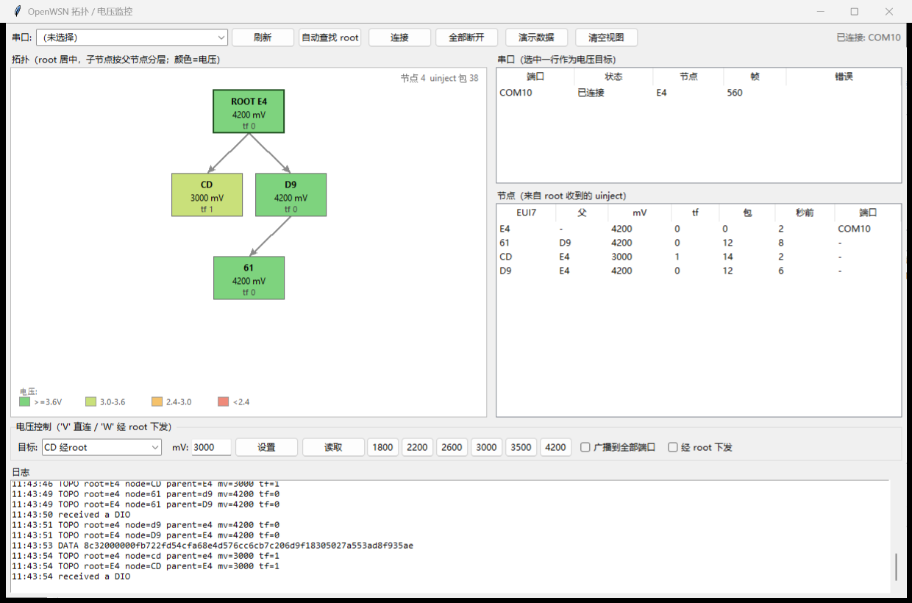

# OpenWSN 拓扑 / 电压监控

两件事合在一套工具里：

1. **改电压**，两种走法：
   - `'V' + 2 字节大端 mV`（HDLC 帧）发给**那块板自己的串口**；
   - `'W' + eui7 + 2 字节大端 mV` 发给 **root 的串口**，root 把
     `"SETVOLT"+eui7+mV` 广播到网里，目标节点收下后转给
     `energy_aware_setVoltage()`。`'W'` 不需要目标节点连电脑，
     是"只连 root"的部署形态用的；两跳以上的节点由中间节点转发一次（TTL=3）。
   两条路都立刻改写 `current_voltage`、`energy_vars.voltage_mV`、
   `e_surplus_uJ` 和 `throttle_factor`。
2. **看拓扑**：每个 leaf 把自己当前的电压放进 uinject 包发给 root；
   root 用串口把整个包（`'D'` 帧）转发给 PC；本工具解出
   `mv / tf / eui7 / parent7`，画出树并标出每个节点的电压。
   **所有状态都从 root 一个口读出来**，其他节点不需要连电脑。

## 数据通路

    上行（状态）leaf --uinject(35B 尾部带 mv/tf/eui/parent)--> root
         root --UART--> 'D' 帧: 'D' + addr16(2) + asn(5) + myEUI64(8) + prevhopEUI64(8) + packet
         PC   --hdlc.py--> openwsn_proto.parse_frame() --> model.TopologyModel --> wsn_gui.py

    上行（自制板做 root，无 UART）root --openserial 字节流--> RTT 通道 0 "Terminal"
         --SWD--> JLinkRTTLogger --日志文件--> rtt_link.py --hdlc.py--> 同一套 'D'/'F' 帧
         （镜像是 UART 转义**之前**的字节，所以解帧不再反转义，见下面 RTT 一节）

    下行（控制）PC --'W' eui7 mV--> root --UDP SETVOLT to ff02::1a--> 全网广播
         （目标节点应用并立刻回一包；中间节点听到后各转发一次，TTL 递减）
         PC --'V' mV--> 那块板自己的串口（直连时用）

root 另外还会为每个 uinject 包打印一行 `TOPO root=.. node=.. parent=.. mv=.. tf=..`。
**界面不拿这行当数据源**：同一条包还会以 `'D'` 帧发出来，只有 `'D'` 帧带 uinject 自己的
16 位计数器（`openapps/uinject/uinject.c:542-544`，载荷偏移 7），而判断新旧只能靠它。
所以实时 `TOPO` 行既不记日志也不改状态，状态一律走 `'D'` 帧的 `apply_uinject()`；
只有 `snap=1` 的缓存重放行（见下）仍然生效。

为什么要计数器：一条包里的 parent 是**组包那一刻**写死的（`uinject.c:576`），
下一跳在入队时定死（`openstack/03b-IPv6/forwarding.c:425-437`）。换父前后，
先组好的包可能后到 root，root 收到就打印，界面上看起来就是"父节点又切回去了"
（实测切换后 14 s 仍打印旧父，39 s 才出现新父）。`apply_uinject()` 的做法：
编号等于已用的、或往回退且不满足重启判据（回退 >100 或该节点静默 >30 s）的包，
打 `TOPO late packet dropped node=.. seq=.. < .. (keep parent=..)` 丢掉，父节点保持不变。

**注意**：DAG root 上单播包不会进本地 UDP 栈
（`openstack/03a-IPHC/iphc.c:281-309`：root + 非广播 → 只走 `openbridge_receive()`），
所以这行不是从 uinject 的 socket 回调里打的，而是在
`openstack/03a-IPHC/openbridge.c:84` 里加 `'D'` 帧头**之前**调
`uinject_cacheFromPacket()`（`openapps/uinject/uinject.c:200`）打的。
它同时负责喂 `'T'` 用的缓存。

root 还保存着**每个子节点最后一次上报**（8 条表项）。PC 连上后发一帧 `'T'`，
root 在 0.5 s 内把整张表按同样的 `TOPO ...` 格式重放一遍，
所以界面一连接就能画出整棵树，不用等每个节点下一次发包
（节点每 10 s 发一包，转发节点约 16 s，刚掉父节点的节点可能几十秒才发一次）。
表项存在 root 的 RAM 里，root 复位后清空。

## RTT 监控（自制板做 root，没有串口线）

自制板就是最终的 DAG root：实验时其他节点部署在各处，只有它离电脑最近，
一根 USB 给 J-Link 即可。它没有可用的 UART（`SUPER_LOW_POWER` 镜像连 `openserial_init()`
都不执行），所以固件把**本来要发给串口的整条字节流**镜像进 RAM 里的 SEGGER-RTT 环，
探针经 SWD 读出来——上位机拿到的字节和串口上的完全一样，`hdlc.py` /
`openwsn_proto.parse_frame()` / `model.py` 都不用特判。

固件（`code/openwsn-fw`）：

- `bsp/boards/nrf52840_dk/rtt_console.c/.h`：静态铺一个 SEGGER-RTT 控制块
  （`"SEGGER RTT"`、up channel 0 = `"Terminal"`、1024 B 环、`Flags=0` 满了就丢），
  对外只有 `rtt_console_writeByte()` / `rtt_console_write()`。带初值的静态变量，
  不需要初始化调用；`scons` 自动收 `bsp/boards/nrf52840_dk/*.c`。
- `drivers/common/openserial.c`：新增 `outputHdlcByte()`，原来 4 处直接写 `outputBuf`
  的地方（开标志、转义字节、正文、关标志）全改成走它，它在写环形缓冲之后调
  `rtt_console_writeByte()`。放在这一层有三个好处：①串口只有这一个出口，漏不掉字节，
  且 `'D'`/`'F'` 帧和 printf 都在里面；②这 4 处都在 `DISABLE_INTERRUPTS()` 里，
  RTT 写天然无竞争；③写缓冲没有"有没有空位"的闸门，所以即使 UART 没初始化、没人排空
  `outputBuf`，镜像照样完整。

上位机：

- 端口下拉里每个探针多一项 `RTT:<SN>  J-Link PLUS`（`ShowEmuList` 枚举，
  见 `rtt_link.list_rtt_probes()`），选中后点**连接**，连过的会写进 `last_ports.json`。
- `rtt_link.RttLink` 起 `JLinkRTTLogger -USB <SN> -RTTSearchRanges "0x20000000 0x00040000"
  -RTTChannel 0 <临时日志>`：logger 状态走 stdout（`Control Block...OK` 就是"找到了"），
  数据只进日志文件，tail 那个文件得到的就是字节流。
- `hdlc.Framer(xonxoff=False)`：镜像点在 UART 转义**之前**，0x11/0x13/0x12 在这里是普通
  载荷字节，不能再反转义（`selftest.py` 有两条检查盯着）。之后就是
  `openwsn_proto.parse_frame()` → `model.handle_frame()`，和串口那条路完全一致。

三条限制：

1. **只上行**。没有 down-channel 读取，`'V'`（直连改电压）、`'M'`、`'T'` 都发不出去，
   界面在 RTT 端口上自动跳过这些命令。`'T'` 其实不需要：root 自己每 `UINJECT_SNAP_TICKS`
   重放缓存，界面连上十几秒内就能画出整棵树。
2. **烧录前先断开**：`JLinkRTTLogger` 一直占着探针，这时 J-Link 报 emulator in use。
   界面里断开该 RTT 链路（或关掉界面）再烧。
3. 连上瞬间会先吐出环里剩下的旧字节，可能出现 1 个不完整帧（日志里的 `badframe`），
   之后正常。

2026-11-14 实测：`rtt_root.hex`（DAGROOT=1 + SLOTSKIP=1 + SLOT… 见下，sha256
`bce0dfff…b77987f`）烧在 0x32 做 root，E4 烧 `leaf_ss0.hex` 当孩子：
45 s 收到 11208 字节 / 498 帧 / 1 坏帧，模型得 `root=32`、`node e4 parent=32 mv=4200 tf=0`，
TOPO 每 10 s 一条，`snap=1` 重放也照常生效。复跑：`.build/tmp/rtt_test_root.py <秒> <SN>`。

## 离线节点会被移出拓扑

节点每 10 s 左右发一包，节流（tf>0）或转发节点最慢也就几十秒一次。界面上限是
**300 s 没收到任何包就认定离线**：`model.prune_offline()` 把这个节点从 `nodes`
里删掉，画布和节点表里立即消失，日志打一行
`节点 BA 离线：312 s 没收到包，从拓扑移除`；它原来的孩子这时失去父指针，
先按“未挂靠”画在 root 下一层，等它下一次上报再挂回去。

三个刻意的选择：

1. **root 永远不删**。root 就是串口上那块板，它自己不参加 `node=` 上报，只转别人
   的行；全网安静时把它删掉，界面就什么都不剩了。
2. **`snap=1` 的快照不能把节点复活**。root 会周期性重放缓存（`UINJECT_SNAP_TICKS`）
   和响应 `'T'`，那是历史；只有**真包**（`'D'` 帧）才能让节点回到拓扑，回来时
   打一行 `节点 BA 重新上线：又收到包，加回拓扑`。
3. 阈值在工具栏“离线: [300] s 无包即移除”里改（30–3600 s），改完立即生效，
   不用重连。

## 文件

| 文件 | 作用 |
| --- | --- |
| `hdlc.py` | HDLC 组帧/解帧 + **XON/XOFF 反转义**（mote 的 `uart_writeByte()` 会转义 0x11/0x13/0x12，不做这层长帧 CRC 必错） |
| `openwsn_proto.py` | 帧类型、`'D'` 帧布局、uinject 尾部解析（含 counter）、TOPO/EA 文本解析、`'V'`/`'W'`/`'M'` 帧构造 |
| `link.py` | 一个串口一条后台线程，负责收发与重连 |
| `rtt_link.py` | 一个 J-Link 一条后台线程：起 `JLinkRTTLogger`（`-USB <SN>`，不弹选择框），tail 它写的日志文件 → `hdlc.Framer(xonxoff=False)` → 和串口一样的帧事件；只上行 |
| `model.py` | 拓扑模型（root、父子关系、每节点 mV/tf、端口↔节点绑定） |
| `wsn_gui.py` | Tkinter 界面：串口表 + 节点表 + 拓扑画布 + 电压面板 + 日志 |
| `cli.py` | 命令行版：`--set / --read / --listen` |
| `watch.py` | 只连一个口，把 TOPO 行实时打出来（最快的连通性检查） |
| `set_voltage.py` | 对单个口发 `'V'`（读或写），打印板子的回执 |
| `e2e_voltage.py` | 端到端验证：给 leaf 改电压，同时看 root 的 `'D'` 帧里 mv 有没有跟着变 |
| `echo_test.py` | 串口完整性自检：发 `'S'+N 字节`，看回显帧能否原样解出（验证 XON/XOFF + CRC） |
| `selftest.py` | 无需硬件的自检（组帧、`'D'`/uinject 解析、拓扑模型） |

## 运行界面

    cd E:/Project/6TiSCH/battery-free/host
    E:/Project/6TiSCH/OpenWSN_serial_parser/venv/Scripts/python.exe wsn_gui.py COM8 COM10 COM11 COM13

命令行上给几个口就自动连几个（也可以只开界面再点“连接”）。

双击 `start.bat`（不带参数）时：

1. 先读 `last_ports.json`，把上次连过的口自动连上（每次连接/断开都会写这个文件）；
2. 没有这个文件（第一次跑）就自动扫描，两路一起扫：
   - 所有描述里带 `JLink` 的 **CDC 串口**（DK 的 UART 从这儿出来），
   - 所有 J-Link 探针的 **RTT 环**（自制板没有 UART，只能走这里，见上面 RTT 一节）。

   有帧的留下、没帧的关掉；对留下的串口发 `'V'`（读电压、认节点）和 `'T'`（要拓扑快照），
   RTT 只上行所以不发命令。扫描结果也写进 `last_ports.json`，下次直接连。

   同一个探针的串口和 RTT 环会同时“说话”（固件把串口流镜像进了 RAM，DK 两者都有），
   界面只留串口那条并打印 `<RTT:SN> 与同一探针的串口重复，只用串口`——探针腾出来好烧录。
   自制板只有 RTT，所以它的 root 照常留下。

工具栏的 **自动查找 root** 按钮可以随时重跑一遍这个扫描。

界面操作：

1. 顶部选串口 → **连接**；可以连多个（root 一个口，每块 leaf 各一个口）。
   下拉框默认停在“（未选择）”，不会替你预选任何口——列表里的 COM3/COM4/COM5/COM6
   都不是本次测试的板子（见下面“串口选择”）。
2. 底部“目标”下拉框按**节点**列出，不是按串口：
   `E4 root @COM10`（这块板连在这台电脑的 COM10）、
   `D9 @COM11`（连在本机）、
   `61 经root`（**没有连本机**，命令由 root 转发）。
   选好节点、填 mV、点 **设置** 或快捷按钮 1800/2200/2600/3000/3500/4200：
   - 目标连在本机 → 发 `'V'` 给那个口（一跳，最快，不入网也能改）；
   - 目标没连本机 → 发 `'W'` 给 root，root 广播下去。广播没有 ACK，
     界面会等节点自己上报新的 mV 来确认；20 s 没动静就自动重发，最多 3 次（窗口 80 s），
     日志里能看到 `已下发：等待节点 … 上报`、`重发 W …` 和 `节点 XX 已确认 YYYY mV`。
     实测回路 2–6 s，但节流（tf>0）或刚换父的节点要等自己的上行 slot，30 s 以上也出现过；
     以前 12 s×2 的窗口会误报"没有确认"。
   - 勾 **经 root 下发** 可以强制让本机节点也走 `'W'`（测下行链路用）。
   - 勾 **广播到全部端口** 则给所有已连接的口各发一个 `'V'`。
   在“节点”表里点一行也会把目标切到那个节点（并带出它当前的 mV）。
3. **读取**：目标连在本机就发裸 `'V'`（回 `EA voltage=<mV> mV tf=<n> eui=<eui7>`）；
   远端节点则发 `'T'`，让 root 重放它缓存的那一行 `TOPO`。
4. **演示数据** 不接硬件也能看界面效果。

> 节点表的“端口”列只表示**这块板是否连在本机**：远端节点永远是 `-`，
> 它们的 mv/tf/parent 全部来自 root 转发的 uinject。

界面里：方块颜色按电压分档（≥3.6 V 绿、3.0–3.6 黄绿、2.4–3.0 橙、<2.4 红），
方块里是 EUI7 / mV / tf；箭头是“子 → 父”。

## 命令行

    V=E:/Project/6TiSCH/OpenWSN_serial_parser/venv/Scripts/python.exe
    $V watch.py COM10 20                 # 20 秒内打印 root 转发的每个 uinject
    $V set_voltage.py COM11 3000         # 把 0xD9 这块板设成 3000 mV，再设回 4200
    $V cli.py --port COM10 --listen 30   # 多口监听
    $V e2e_voltage.py COM11 COM10 3000   # 端到端：改 leaf 电压，看 root 侧 mv 变化
    $V echo_test.py COM10 80             # 80 字节回显，验证串口链路

## 固件构建

    export PATH="/d/GNU_Tools_for_Arm/9 2019-q4-major/bin:/d/Python/Scripts:$PATH"
    D:/Python/python.exe code/tools/apply_config.py --dagroot 0 --slotskip 0 --sf 101 \
        --voltage 4200 --forcetopology 0 --eb-portion 1
    cd code/openwsn-fw
    rm -rf build/nrf52840_dk_armgcc
    scons board=nrf52840_dk toolchain=armgcc apps=uinject boardopt=uart-vcom oos_openwsn
    arm-none-eabi-objcopy -O ihex build/nrf52840_dk_armgcc/projects/common/03oos_openwsn_prog.exe leaf.hex

root 用 `--dagroot 1` 再编一次（`config.h` 里的 `DAGROOT` 是编译期常量，必须编两版）。
`text` 大约 98 KB。

烧录（J-Link）：

    D:/SEGGER/JLink_V810/JLink.exe -NoGui 1 -CommandFile flash.jlink -SelectEmuBySN <sn>
    # flash.jlink: si SWD / speed 4000 / device nRF52840_xxAA / connect /
    #              loadfile <hex> / r / g / qc

## 串口引脚（关键）

`boardopt=uart-vcom` 时固件用 **DK 板载 VCOM**：RX P0.08 / TX P0.06，
即插 DK 的 USB 就能收发，不需要 USB-TTL。
不传这个选项时是 battery-free mote 的默认引脚 RX P0.02 / TX P0.04（= debugpins 的 SLOT/TASK）。

    code/openwsn-fw/bsp/boards/nrf52840_dk/uart.c
    #ifdef UART_PINS_VCOM
      RX = NRF_GPIO_PIN_MAP(0,8), TX = NRF_GPIO_PIN_MAP(0,6)   // PCA10056 VCOM0
    #else
      RX = NRF_GPIO_PIN_MAP(0,2), TX = NRF_GPIO_PIN_MAP(0,4)   // mote 默认
    #endif

一块 DK 有两个 CDC：**只有第二个是 VCOM**（例如 1050227853 是 COM9/COM10，用 COM10；
1050255521 是 COM12/COM13，用 COM13）。选错口一个字节都收不到。

### 串口选择（2026-11-14 现状，两块板）

| 口 / 链路 | 探针 SN | 板子 | 角色 |
| --- | --- | --- | --- |
| `RTT:602719539` | 602719539 | 自制板 | **root**（EUI7 0xB4）：没有 UART，整条串口流镜像进 RTT |
| COM10 | 1050227853 | DK | 部署节点（EUI7 0xE4），跑 `leaf_ss0.hex`；只当孩子用时不用连它 |

COM14 是 602719539 那路 CDC，但自制板镜像不带 UART，**这个口一个字节都不会有**，
连它只会看到"打开中"。要看这块板的输出就用 `RTT:602719539`（见上面 RTT 一节）。

要跑"DK 当串口 root"的老配置：E4 烧 `v37_root.hex`、界面连 COM10，
自制板那边就别连了。

> 自制板 2026-11-17 换过一块：换下来的那块 EUI7 是 0x32（旧文档里到处是它），
> 现在探针 602719539 上这块自报 **0xB4**。EUI7 直接来自芯片 FICR DEVICEID
> （`bsp/boards/nrf52840_dk/eui64.c:31-38`），所以换了板号就变。

**COM3 / COM4 / COM5 / COM6 与本次测试无关，不要连：**
COM3/COM4 属于 SN 1050284179（另一个项目，别烧也别复位），COM5 是 CH343，
COM6 是 CH340（PPK2，发什么回什么）。

## 帧格式速查

| 方向 | 帧 | 内容 |
| --- | --- | --- |
| mote→PC | `'F'` | `addr16(2) + asn(5) + 文本`（printf） |
| mote→PC | `'D'` | `addr16(2) + asn(5) + myEUI64(8) + prevhopEUI64(8) + packet` |
| mote→PC | `'S'` | `asn(5) + 状态` |
| PC→mote | `'V'` | 裸 `'V'` 读；`'V' + mV_hi + mV_lo` 写（clamp 到 1800..4200） |
| PC→mote | `'T'` | 让 root 重放它缓存的每个子节点最后一次 `TOPO` 行（leaf 忽略） |
| PC→mote | `'W'` | `'W' + eui7 + mV_hi + mV_lo`：发给 root，由它广播 `SETVOLT` 到全网 |
| PC→mote | `'M'` | 裸 `'M'` 读；`'M' + mode + tmin_s` 设置"工作点变化要不要立刻发 DIO"：0 = 只按正常 DIO 调度（**实验默认**）、1 = 立刻连发 5 个、2 = 立刻发 1 个；tmin_s = 两次强制 announce 的最小间隔（0 = 不限）。掉电复位回到编译默认（0） |
| mote→PC | `'F'` | `SETVOLT tx/relay/rx ...`、`TOPO ...`、`EA voltage=...`、`EA dio mode=...`、`EA announce rank=... burst=...` 都走这 |
| PC→mote | `'S'` | 回显，mote 用 `'D'` 帧回（`7e5366907e` 是裸 `'S'`） |

uinject 包尾部 35 字节：

    "uinject"(7) + 状态(23) + mV 低字节 + mV 高字节 + tf + 自身EUI7 + 父EUI7

HDLC：`0x7e ... 0x7e`，`0x7d 0x5d -> 0x7d`、`0x7d 0x5e -> 0x7e`，
CRC-16/X-25 低字节在前，整帧 CRC 应为 `0xf0b8`。

## 电压变化要不要立刻发 DIO（'M'）

实验阶段电压是连续变化的（电容充放电）。如果每次变化都发 DIO，控制开销就变成
"电压变化速度"的函数，而且会挤占共享 cell——所以**默认关闭**，只有调试才需要：

- 界面"电压控制"面板最右边的 **电压变化立即发 DIO（调试）** 复选框 + **最小间隔 s**，
  点"下发"会给所有已连接的节点发 `'M'`；连上串口时会自动发一次裸 `'M'` 把当前模式
  打进日志（`EA dio mode=0 tmin=15 eui=d9`）。
- 命令行：`set_voltage.py` 不管这个，直接用 `cli.py --port COM11` 或自己发 `'M'`
  （`openwsn_proto.dio_mode_payload(mode, tmin)`）。
- mode 0 时 rank 照样随电压变化，只是等正常的 DIO 调度再宣布（实验行为）；
  mode 1/2 才是"立刻宣布"，用来量换父时延；实测门限生效（11.9 s < 15 s 不发）。

## 2026-11-11 实测：只连 root 管全网（v12）

四块板跑 **v12 镜像**（2026-11-11 11:3x 烧录）：`v12_root.hex` sha256
`1f808e2a…`（text 99997）、`v12_leaf.hex` `663f5bc2…`（99997）、
`v12_c.hex` `dd925276…`（100261，0x61 那块带强制拓扑过滤）。
（v11：`b338db37…` / `4b81370e…` / `27f095f3…`，没有转发；v8–v11 是下行链路的修复过程，
见 `perf/docs/20_ROOT_ONLY_DEPLOYMENT.md`。）

**只连 COM10（root）时**：

- 连上 9 s 内 root 报出全部三个子节点（`TOPO root=e4 node=cd/d9/61 ...`），
  12 s 时又重放一遍带 `snap=1` 的快照；界面不需要连 leaf 的口。
- `'W' eui=D9 3000` → root 打 `SETVOLT tx`，D9 打 `SETVOLT rx mv=3000`，
  root 侧 2 s 后 `TOPO ... node=d9 mv=3000`；界面日志随后出现 `节点 D9 已确认 3000 mV`。
- 两跳节点 0x61（父 0xCD）：root 的广播它经常听不到，靠 CD 转发
  （`CD SETVOLT relay eui=61 mv=2600` → `61 SETVOLT rx mv=2600`，2 s 后应用，
  root 侧 +14 s 确认）。
- 六次命令实测 5 次一次成功（+2.0 s ~ +6.0 s 确认），1 次首包丢、界面重发后成功；
  0x61 在加转发之前是 0/1，加转发后 2/2。

## 2026-11-11 21:1x 实测：v28（DIO 回到 10 s）与迟到包过滤

四块板跑 **v28 镜像**（`v28_root` `7b452769…`、`v28_leaf` `2c0431b4…`、`v28_c` `135a05d7…`，
text 100893/100893/101157）。只连 COM10，330 s：

- uinject 上报周期：CD、D9 各约 10.2 s 一个包（`UINJECT_PERIOD_MS` 10 s），61 换父后 10.1 s；
  DIO 是 10 s 定时器 × `DIO_PORTION 3` 抽签（平均 30 s），所以 61 换父用了 61 s；
- 30 s 时把 D9 写到 2000 mV，48 s 上报 `mv=2000 tf=3`，61 在 **91.8 s** 报到 `parent=CD`
  （DIO 10 s × PORTION 3，实测 61 s）；
- **96.6 s 打出一行 `TOPO late packet dropped node=61 seq=7 < 9 (keep parent=CD)`** ——
  这正是换父前组好的包晚到 root 的那一条，没有过滤就会把父节点显示回 D9；
- 150 s 把 D9 写回 4200 mV，161.2 s 又挡下一条 D9 的旧包（`seq=18 < 22`）；
- 全程 `data_frames=91 topo_lines=114 late_dropped=2`，界面上的父节点一次都没回退。

（第一次 330 s 跑失败是 `PermissionError(13)`：界面占着 COM10，所以那次数据作废。）

## 2026-11-10 实测记录（三块 DK）

| 角色 | J-Link SN | 串口 | EUI7 | 说明 |
| --- | --- | --- | --- | --- |
| root | 1050227853 | COM10 | 0xE4 | DAGROOT=1，转发 `'D'` 帧 |
| leaf | 683260444 | COM11 | 0xD9 | 父节点 0xE4 |
| leaf | 1050255521 | COM13 | 0xCD | 父节点 0xE4 |
| leaf | 1050208732 | COM8 | 0x61 | 父节点 0xCD（两层），固件带强制拓扑过滤 |

四块板跑的都是 **v5 镜像**（2026-11-10 22:0x 烧录，`EB_PORTION` 由 1 改回 3 ——
这是「广播收不到、邻居 rank 冻结、父亲不切换」的根因，见
`perf/docs/19_EB_PORTION_BROADCAST_STARVATION.md`）：`v5_root.hex` sha256 `4f4b800c…`（text 98821）、
`v5_leaf.hex` sha256 `4746e097…`（98821）、`v5_c.hex` sha256 `12ed5bbb…`（0x61 那块，text 99085）。
（上一版 v4：`621c561a…` / `250c4efe…` / `232f519c…`；再上一版 v3：`71735082…` / `7b0341f0…` / `4b456e4f…`。）

**父亲切换已实测可用（v5）**：把 0xD9 设成 2000 mV（tf=3，rank 512→2138）后，
0x61 在 20 秒内从 0xD9 切到 0xCD（root 串口 `node=61 parent=d9` → `parent=cd`）；
反过来把 0xCD 设成 2000 mV、0xD9 设回 4200 mV，0x61 又切回 0xD9
（J-Link 读 `parentIdx=1`、rank 1380 = 527 + 853）。切换后 6P 要重新协商 cell，
该节点在我方串口重新出现约需 40–70 s。

连上界面后 2 s 内四块板全部出现（`'V'` 回执绑端口，`'T'` 快照补拓扑），
不再需要等每个节点下一次 uinject。

**上报周期 10 s**（`openapps/uinject/uinject.h:17` `UINJECT_PERIOD_MS 10000`）：
2026-11-10 17:0x 在 root 上量到 0xD9 / 0xCD / 0x61 全部 10.1 s 一行
（v3 时 0x61 是 ~16 s，因为它刚换父、rank 还在跳，发送完成回调偶尔丢；rank 稳定后不再丢）。
把父节点 0xCD 设成 2000 mV（tf=3）后，0xCD 与 0x61 的实际上报率会掉到 20–40 s——
这是节流本身的设计（每 4 个 slotframe 只用一个），不是界面或固件故障。

- `set_voltage.py COM11 3000` → 回执 `EA voltage=3000 mV tf=1 eui=d9`，
  紧接着 root 侧 `'D'` 帧里 0xD9 的 mv 变成 3000、tf 变成 1；设回 4200 后又变回 4200/0。
- `set_voltage.py COM13 2600` → `EA voltage=2600 mV tf=2 eui=cd`，root 侧同步。
- 界面截图（三块板同时连着）：root 0xE4 4200 mV，子节点 0xCD 2600 mV tf2、0xD9 3000 mV tf1。

## 常见问题

- **一个字节都收不到**：串口选错（选到第一个 CDC 而不是 VCOM）、
  或者固件没带 `boardopt=uart-vcom` 而你又没接 P0.02/P0.04。
- **能收到帧但 CRC 全错**：`hdlc.py` 里的 XON/XOFF 反转义被绕过。
- **`'D'` 帧只有 7 字节**：`openserial_printData()` 里拷贝 payload 的那段
  被 `#if OPENWSN_UTEMPERATURE_C` 包住了，见 `drivers/common/openserial.c`。
- **leaf 永远 `isSync=0`、root 却在正常发包**：先看 `NRF_CLOCK->HFCLKSTAT`
  的 SRC 位——如果是 0（内部 RC，±2%），射频对不上频，RX 永远收不到 SFD。
  正确值是 `0x00010001`。
- **点了设置但电压不变**：先看日志里有没有 `TX COMxx  V 2200 mV  ok`。
  没有这行说明**没选中目标**（目标框空着），旧版本这里只写一行日志、很容易被别的输出淹没；
  现在没选目标会弹提示音并在日志/状态栏红字提示。
  有 TX 但没有 `EA voltage=` 回复，说明帧没到 mote
  （接线/波特率/串口选错），有回复但值被改小说明被 clamp 到 1800。
- **某个节点要等很久才出现**：现在连接时会发 `'T'`，root 把缓存重放一遍，
  正常 2 s 内整棵树就出来了。如果某个节点连快照里都没有，说明 root 压根没收到过它的包
  （该节点没入网、或它的父节点没转发），不是界面问题——用 `watch.py COM10 60`
  看 root 到底收到了谁的 uinject。
- **快照里的电压是旧值**：`'T'` 重放的是 root 记下的最后一次上报；节点静默时这就是它的最后已知值，
  等它下次发包会自动刷新。root 复位后缓存清空。
- **父节点显示"换回去了"**：那是**迟到包**，不是 RPL 又切回去了。包里的 parent 是组包时写死的，
  换父瞬间在途/排队的那条会晚到 root，日志里就会出现 `parent=` 老父的一行。
  换父后还要等新父拿到 TX cell（MSF housekeeping，实测 35–39 s），这段静默期里到 root 的
  只能是旧路径上的包。现在 `model.py` 用 uinject 的 16 位计数器丢旧包：
  日志出现 `TOPO late packet dropped ...` 就是它挡下来了，父节点不会跟着回退。
- **界面卡住不动（日志/画布都不再变，但串口表里的“帧”计数还在涨）**：旧版本的
  `_drain()` / `_tick()` 是 Tk 的 `after` 链，任何一帧解析抛异常就会把整条链打断，
  表现就是界面永久冻结。现在两处都包了 `try/except`，异常会写进 `host/gui_error.log`，
  界面继续刷新。真遇到卡住，先看这个文件。
- **改了电压但拓扑没动**：父节点掉压后子节点要等下一轮 DIO 才改判。周期 DIO 是
  `DIO_PERIOD(10 s) × DIO_PORTION(3)`，所以默认要几十秒；掉压瞬间的"立刻重算 rank + 连发 DIO"
  只在调试模式（`'M'` 设 1 或 2）里才有，默认关，以免把 DIO 速率变成电压变化的函数。
  换父后新父还没有 TX cell，要等 MSF housekeeping（30 s），界面再晚 35–39 s 更新。
  见 `perf/docs/21_FORCED_DIO_AND_SHARED_ALOHA.md` 与 `perf/docs/22_LATE_UINJECT_PACKETS.md`。
- **点了设置却报"没有确认"**：两种情况。①窗口太短：v21 及以前是 12 s×2，而命令要过
  共享 cell 的门控，实测 `'W' D9 2600` 用了 37 s 才回来；v22 起应用广播不走门控，
  窗口也放宽到 20 s×4。②命令真没到：看 root 日志有没有三条 `SETVOLT tx eui=..`；
  有就说明发出去了，等节点上报即可（目标板自己的串口会打 `SETVOLT rx mv=.. seq=..`）。
- **电压在两个值之间来回跳**：v21 及以前旧命令的副本还留在网里，迟到的副本会盖掉新值。
  v22 给命令加了 seq，旧副本到达目标节点时打 `SETVOLT stale seq=.. last=..` 并被丢弃。

## 自检

    E:/Project/6TiSCH/OpenWSN_serial_parser/venv/Scripts/python.exe selftest.py

会验证 `'S'` 帧 = `7e5366907e`（与固件实测一致）、`'D'` 帧 + uinject 尾部解析、
TOPO 深度计算、端口绑定等。
